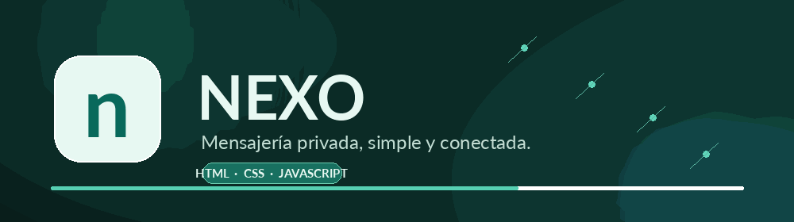
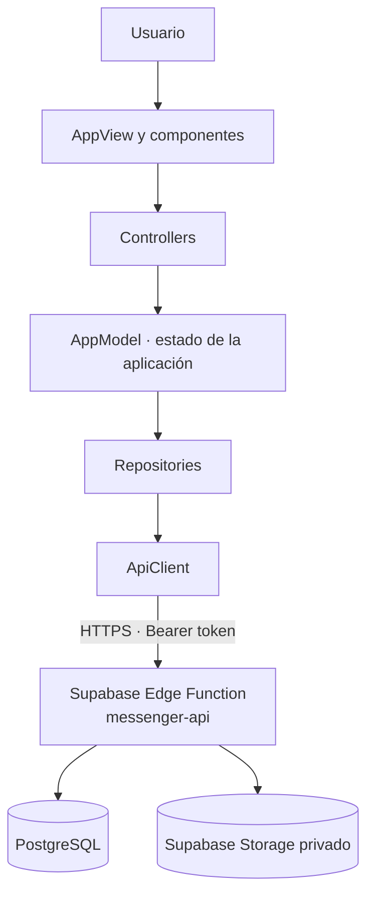

<div align="center">
  

  <p><strong>Una experiencia de mensajería web enfocada en la claridad, la privacidad por sesión y una interfaz adaptable.</strong></p>

  <p>
    
    
    
    
    
  </p>
  <p>
    
    
    
  </p>
</div>

<p align="center">
  <a href="#vista-general">Vista general</a> ·
  <a href="#funcionalidades">Funcionalidades</a> ·
  <a href="#arquitectura">Arquitectura</a> ·
  <a href="#puesta-en-marcha">Puesta en marcha</a> ·
  <a href="#despliegue-en-github-pages">GitHub Pages</a> ·
  <a href="#seguridad-y-privacidad">Seguridad</a> ·
  <a href="#pruebas">Pruebas</a>
</p>

---

## Vista general

**Nexo** es una aplicación de mensajería web construida con HTML, CSS y JavaScript moderno (módulos ES nativos). Su interfaz se publica como sitio estático y utiliza **Supabase** para la persistencia de datos, el almacenamiento privado y una Edge Function que concentra las operaciones de la aplicación.

El proyecto está diseñado para funcionar en navegadores de escritorio, tabletas y teléfonos. Incluye conversaciones privadas, grupos, administración de contactos, presencia, recibos de mensajes, archivos adjuntos, notificaciones y gestión de sesiones.

> **Principio de arquitectura:** el navegador presenta la aplicación y coordina las interacciones; las reglas de negocio, la identidad de la sesión y la autorización de recursos se validan en el backend.

## Funcionalidades

### Cuentas, perfiles y contactos

- Registro e inicio de sesión mediante el sistema de autenticación propio de Nexo.
- Recuperación y restablecimiento de contraseña mediante enlace.
- Perfil con nombre visible, nombre de usuario, biografía y fotografía.
- Búsqueda de usuarios por nombre de usuario o nombre visible.
- Solicitudes de contacto: enviar, aceptar, rechazar y cancelar.
- Gestión de contactos y controles para bloquear o desbloquear usuarios.
- Sesiones de acceso por dispositivo, consulta de sesiones activas y revocación individual o global de las demás sesiones.

### Conversaciones y mensajería

- Conversaciones privadas entre contactos aceptados.
- Creación idempotente de conversaciones privadas: evita duplicar el chat cuando ambos participantes lo abren simultáneamente.
- Historial paginado y sincronización incremental de mensajes.
- Envío de texto, respuestas a mensajes y reacciones con emojis.
- Edición de mensajes propios dentro de la ventana permitida por el backend (15 minutos).
- Eliminación lógica de mensajes propios, conservando una indicación en el historial.
- Estados de envío, entrega y lectura basados en los recibos que registra el servidor.
- Indicador de presencia y estado de escritura, sujetos a las preferencias de privacidad de cada cuenta.

### Grupos

- Creación de grupos con nombre, descripción y contactos aceptados (entre 2 y 50 integrantes, incluido el propietario).
- Administración de información y fotografía del grupo.
- Consulta de integrantes, incorporación y retirada de participantes.
- Roles de propietario y administrador, con permisos diferentes.
- Validaciones del backend para impedir que un integrante sin permisos modifique la configuración del grupo.

### Archivos y contenido multimedia

- Adjuntos en conversaciones con carga multipart.
- Imágenes, PDF, TXT, documentos de Word, hojas de cálculo, presentaciones y archivos ZIP.
- Límite de 10 MiB por adjunto de conversación; las fotografías de perfil tienen un límite independiente de 5 MiB.
- Validación de tamaño, MIME, extensión y firma del archivo en el servidor.
- Almacenamiento en el bucket privado `messenger-private`.
- URLs firmadas de corta duración para previsualizar o descargar archivos autorizados.

### Notificaciones, búsqueda y preferencias

- Bandeja de notificaciones dentro de la aplicación.
- Marcar una notificación o todas como leídas.
- Notificaciones del navegador cuando la aplicación está abierta y el permiso está concedido.
- Preferencias de tema claro, oscuro o del sistema; sonidos, previsualizaciones y notificaciones.
- Búsqueda de conversaciones y mensajes dentro de los chats a los que pertenece la cuenta.
- Panel de preferencias para consultar y administrar sesiones de dispositivos.

### Experiencia de uso

- Diseño adaptable para móvil, tablet y escritorio.
- Navegación interna con rutas hash, compatible con hosting estático.
- Panel de detalles de conversación que se puede cerrar independientemente del chat abierto.
- Modales que conservan su estado durante las actualizaciones de sincronización.
- Mensajes de retroalimentación con contraste, estados y jerarquía visual diferenciados.
- Diseño basado en variables CSS, con tema claro y oscuro.

## Arquitectura

Nexo utiliza una separación por responsabilidades inspirada en MVC. Las vistas no consultan directamente la base de datos y los controladores coordinan las acciones del usuario con el estado de la aplicación.



### Capas del frontend

| Capa | Responsabilidad | Ubicación |
|---|---|---|
| App | Inicio, enrutamiento y composición de dependencias | `src/app/` |
| Views | Renderizado de pantallas, formularios y componentes | `src/views/` |
| Controllers | Eventos, validaciones de interacción y coordinación | `src/controllers/` |
| Model | Estado central, carga y sincronización de información | `src/models/AppModel.js` |
| Repositories | Contratos de acceso a las acciones remotas | `src/models/repositories/` |
| Services | Cliente HTTP, gestión de sesión y transporte | `src/services/` |
| Styles | Tokens, componentes, layout y media queries | `src/styles/` |
| Utils | Formato, escape y utilidades compartidas | `src/utils/` |

### Backend

La Edge Function `messenger-api` concentra las acciones de autenticación, perfiles, contactos, conversaciones, grupos, mensajes, archivos, notificaciones, preferencias, búsqueda y sesiones. La aplicación utiliza PostgreSQL para los datos estructurados y Storage para los objetos privados.

**Sincronización:** la actualización de mensajes y presencia usa solicitudes HTTP autenticadas periódicas a la Edge Function. No es un canal WebSocket ni una suscripción Supabase Realtime. La conversación abierta se consulta aproximadamente cada 4,5 segundos; los resúmenes se actualizan con menor frecuencia y se fuerza una sincronización al recuperar conectividad o volver a la pestaña.

## Tecnologías

| Tecnología | Uso en Nexo |
|---|---|
| HTML5 | Estructura semántica de la aplicación |
| CSS3 | Diseño responsive, temas, transiciones y componentes |
| JavaScript ES Modules | Lógica del cliente sin framework ni bundler obligatorio |
| Supabase Edge Functions (Deno) | API, validación de sesión y reglas de negocio |
| Supabase PostgreSQL | Cuentas, perfiles, conversaciones, mensajes y metadatos |
| Supabase Storage | Almacenamiento privado de archivos y avatares |
| GitHub Actions | Suite automatizada y publicación en GitHub Pages |
| Node.js 22 | Ejecución local de las pruebas automatizadas |

## Puesta en marcha

### Requisitos

- Navegador moderno con soporte para JavaScript ES Modules.
- Python 3, PHP o cualquier servidor HTTP estático para ejecutar la aplicación localmente.
- Node.js 22 para ejecutar la suite automatizada.
- Acceso al proyecto Supabase ya configurado para utilizar el backend.

No se requiere `npm install`, compilador, framework frontend ni proceso Node.js permanente.

### 1. Obtener el proyecto

Clona el repositorio o descarga el ZIP y entra en la carpeta raíz del proyecto:

```bash
git clone https://github.com/USUARIO/REPOSITORIO.git
cd REPOSITORIO
```

Sustituye `USUARIO/REPOSITORIO` por la dirección real del repositorio. Si ya descargaste el proyecto, omite `git clone`.

### 2. Iniciar un servidor local

Desde la raíz del proyecto ejecuta:

```bash
python -m http.server 5500
```

Abre `http://localhost:5500` en el navegador.

> No abras `index.html` directamente con `file://`. Los módulos ES y las solicitudes del navegador necesitan un origen HTTP/HTTPS.

### 3. Configuración del cliente

La configuración pública está en `src/config/appConfig.js`:

- `apiUrl`: URL de la Edge Function `messenger-api`.
- `publishableKey`: clave `sb_publishable_` de cliente.
- `requestTimeoutMs`: tiempo máximo de espera de una solicitud.
- `maxMessageLength`: longitud máxima admitida por el cliente.

La URL y la clave publicable que aparecen en ese archivo son datos de cliente. Una clave publishable está diseñada para exponerse en el navegador; **no la sustituyas por una clave `sb_secret_` o `service_role`**.

### 4. Configuración de correo de recuperación

Para habilitar el envío real de enlaces de recuperación, configura estos valores en **Supabase Dashboard → Edge Functions → Secrets**:

| Secreto | Finalidad |
|---|---|
| `APP_BASE_URL` | URL exacta de la aplicación publicada, incluido el subdirectorio del repositorio si aplica |
| `RESEND_API_KEY` | Clave privada de Resend |
| `MAIL_FROM` | Dirección remitente de un dominio verificado en Resend |

`supabase/.env.production.example` contiene marcadores de ejemplo. Si creas un archivo real `supabase/.env.production`, mantenlo fuera de Git. Los secretos privados se configuran en el backend, no en `src/` ni en GitHub Pages.

## Despliegue en GitHub Pages

El repositorio incluye el workflow `.github/workflows/pages.yml`. Al recibir un `push` a `main`, prepara y publica un artefacto estático. También se puede iniciar manualmente desde GitHub Actions.

1. Sube el contenido de la carpeta del proyecto a la raíz de tu repositorio.
2. En GitHub abre **Settings → Pages**.
3. Selecciona **GitHub Actions** como fuente de publicación.
4. Confirma que la rama principal sea `main` o ajusta el disparador del workflow.
5. Haz `commit` y `push` a `main`.
6. En la pestaña **Actions**, comprueba que los workflows de pruebas y publicación terminen correctamente.
7. Abre la URL que GitHub muestra en **Settings → Pages**.

### Qué publica el workflow

El artefacto de Pages contiene únicamente:

```text
index.html
reset-password.html
404.html
public/
src/
.nojekyll
```

No se publican los SQL, documentación, pruebas, ejemplos de secretos ni archivos administrativos de Supabase. Las rutas del frontend son relativas y la navegación utiliza hash routing, por lo que el sitio puede vivir bajo una URL de proyecto como `https://USUARIO.github.io/REPOSITORIO/`.

## Supabase: backend y estado del proyecto

Nexo utiliza el proyecto Supabase configurado en `supabase/config.toml`. La referencia de proyecto incluida en esta versión es `zyfjffvqcprfcohgdrxx` y el endpoint de API se define en `src/config/appConfig.js`.

**Estado remoto comprobado el 12 de noviembre de 2026:** la Edge Function `messenger-api` está activa en la versión 21. Esta versión incluye la corrección de creación de conversaciones privadas para el índice único parcial y recuperación de colisiones cuando dos solicitudes simultáneas intentan crear el mismo chat.

### Importante: sincronizar el código de la Edge Function

La carpeta local `supabase/functions/messenger-api/` es una instantánea de trabajo y **no se ha confirmado que todos sus módulos sean idénticos a los desplegados en Supabase**. El frontend de GitHub Pages consume la función remota ya desplegada; el workflow de Pages no publica ni reemplaza esa función.

**No ejecutes `supabase functions deploy messenger-api` desde esta copia local sin recuperar primero la fuente remota vigente, sincronizar todos los módulos, revisar el diff y probar el resultado en un entorno de staging.** Un despliegue desde una instantánea incompleta podría sustituir lógica remota más reciente.

### Autenticación propia

Nexo no utiliza Supabase Auth. Gestiona sesiones propias con tokens opacos que el cliente envía mediante `Authorization: Bearer`. El backend valida el token y resuelve la identidad del usuario en cada operación privada. `verify_jwt = false` en la configuración de la Edge Function es deliberado para este esquema; no significa que las rutas privadas sean anónimas.

## Seguridad y privacidad

- La identidad del usuario se obtiene de la sesión validada en el servidor; no se confía en un `userId` enviado en el cuerpo para identificar al usuario que llama.
- Las acciones privadas comprueban la sesión y los permisos sobre la conversación, el grupo, el mensaje o el archivo solicitado.
- Las tablas de aplicación mantienen Row Level Security (RLS) y bloquean el acceso directo de los roles públicos de cliente; las operaciones privilegiadas pasan por la Edge Function.
- El bucket `messenger-private` está configurado como privado; los archivos se entregan mediante URLs firmadas temporales.
- El frontend almacena tokens en `sessionStorage`, no en cookies HttpOnly. Esto limita su persistencia al contexto de la pestaña, pero el token sigue siendo accesible al JavaScript de la aplicación; por ello, la prevención de XSS y la política CSP son importantes.
- Los mensajes se escapan y se presentan como texto, no como HTML arbitrario.
- La clave publishable puede residir en el cliente; claves secretas, contraseñas PostgreSQL y credenciales de Resend deben permanecer en Supabase.
- CORS permite el origen de la llamada sin credenciales de cookies. La autorización real de recursos se hace con el token Bearer y las reglas del backend.

> **Alcance de privacidad:** Nexo implementa autenticación, autorización de recursos y almacenamiento privado. Esta versión no implementa cifrado de extremo a extremo (E2EE); el contenido se procesa en el backend para persistencia, sincronización y entrega.

## Pruebas

Las pruebas automatizadas se ejecutan con Node.js 22:

```bash
node --experimental-default-type=module --test tests/*.test.mjs
```

**Resultado de esta versión del proyecto: 57 pruebas aprobadas, 0 fallidas.** La suite cubre, entre otros aspectos:

- Sesiones, renovación y listado de dispositivos.
- Configuración de producción y diagnóstico de conectividad/CORS.
- Perfiles, contactos y operaciones de cuentas.
- Conversaciones privadas, grupos, mensajes y reacciones.
- Sincronización, presencia y estados de mensajes.
- Archivos, notificaciones y preferencias.
- Renderizado y ciclo de vida de modales.
- Etiquetas de dispositivos, panel de detalles y breakpoints responsive.

Las pruebas automatizadas no sustituyen una prueba integral desde navegadores reales. Después de publicar, comprueba login, recuperación, conversaciones entre dos cuentas, carga y descarga de adjuntos, notificaciones y visualización en móvil/tablet/escritorio.

## Estructura del repositorio

```text
nexo-messenger/
├── .github/
│   └── workflows/
│       ├── pages.yml               # Publicación automática en GitHub Pages
│       └── tests.yml               # Pruebas en push y pull requests
├── docs/
│   ├── assets/
│   │   └── nexo-hero.gif           # Cabecera animada de este README
│   └── *.md                        # Arquitectura, despliegue y notas técnicas
├── public/
│   └── favicon.svg
├── src/
│   ├── app/                        # Bootstrap y enrutamiento
│   ├── config/                     # Configuración pública del cliente
│   ├── controllers/                # Controladores de interacción
│   ├── models/
│   │   ├── entities/               # Entidades del dominio
│   │   └── repositories/           # Acceso a las acciones de la API
│   ├── services/                   # ApiClient y SessionStore
│   ├── styles/                     # Tokens, componentes y responsive
│   ├── utils/                      # Utilidades compartidas
│   └── views/                      # Vistas y componentes
├── supabase/
│   ├── functions/                  # Instantánea local; revisar aviso antes de desplegar
│   ├── migrations/                 # SQL disponible y notas del historial
│   └── config.toml
├── tests/                          # Suite automatizada Node.js
├── 404.html
├── index.html
├── reset-password.html
└── README.md
```

## Documentación técnica

| Documento | Contenido |
|---|---|
| [Arquitectura MVC](docs/architecture.md) | Capas, responsabilidades, navegación y flujo de datos |
| [Despliegue](docs/production-deployment.md) | GitHub Pages, secretos y configuración de producción |
| [Seguridad](docs/security.md) | Sesiones, autorización, Storage y controles del cliente |
| [Cuentas y contactos](docs/stage6-accounts-contacts.md) | Perfiles, solicitudes, búsqueda y bloqueos |
| [Mensajes y grupos](docs/stage7-messaging-groups.md) | Reglas de mensajes, roles y operaciones de grupo |
| [Sincronización y presencia](docs/stage8-realtime-presence.md) | Polling, presencia, escritura y recibos |
| [Archivos y notificaciones](docs/stage9-files-notifications.md) | Adjuntos, bandeja, preferencias y sesiones |
| [Corrección de sesiones y conversaciones](docs/conversation-sessions-fix.md) | Creación de conversaciones y listado de sesiones |
| [Ajustes responsive recientes](docs/responsive-device-session-fix.md) | Etiquetas de dispositivos, panel de detalles y tablet |
| [Historial de migraciones](supabase/migrations/README.md) | SQL disponible y reconciliación pendiente |

> Los documentos por etapas conservan notas históricas y pueden mencionar versiones antiguas del backend. Para el estado remoto más reciente, consulta el apartado **Supabase: backend y estado del proyecto** de este README y el aviso `supabase/functions/messenger-api/SOURCE_SYNC_REQUIRED.md`.

## Limitaciones conocidas y decisiones técnicas

- **Sin Web Push:** las notificaciones del navegador solo pueden mostrarse mientras Nexo está abierto y el navegador permite la Notification API. No hay un servicio de push para entregar alertas con el sitio cerrado.
- **Sin WebSocket/Supabase Realtime:** los mensajes y la presencia se sincronizan mediante polling autenticado periódico.
- **Sin E2EE:** el backend procesa los mensajes para almacenarlos y entregarlos; no se debe presentar esta versión como mensajería cifrada de extremo a extremo.
- **Historial de migraciones:** el proyecto remoto conserva dos migraciones históricas cuyos SQL originales no están presentes en este repositorio (`20261110062234_lock_direct_data_api_access` y `20261110225842_auth_refresh_rotation_and_atomic_password_reset`). Además, ciertos SQL de etapas posteriores se aplicaron directamente y deben reconciliarse con el historial de CLI.
- **No reconstruir ni alterar producción a ciegas:** no ejecutes `supabase db push` ni `supabase db reset` contra producción hasta recuperar los dos SQL originales, reconciliar el historial, respaldar la base y revisar el plan de cambios.
- **Prueba de aceptación:** antes de considerar cualquier despliegue como validado, prueba flujos reales en al menos dos cuentas y dos navegadores/dispositivos.

## Flujo recomendado para contribuir o mantener el proyecto

1. Crea una rama de trabajo y conserva una copia de seguridad antes de modificar backend o SQL.
2. Realiza cambios pequeños y enfocados.
3. Ejecuta la suite automatizada completa.
4. Revisa el diff y valida la interfaz en resoluciones móviles, tablet y escritorio.
5. Prueba los cambios de backend en staging y sincroniza la fuente remota antes de cualquier despliegue de Edge Function.
6. Publica el frontend mediante un pull request o un `push` controlado a `main`.
7. Comprueba los workflows y realiza pruebas funcionales en el sitio publicado.

---

<div align="center">
  <strong>Nexo</strong> · Mensajería privada, simple y conectada.
  <br>
  <sub>Construido con HTML, CSS, JavaScript y Supabase.</sub>
</div>
